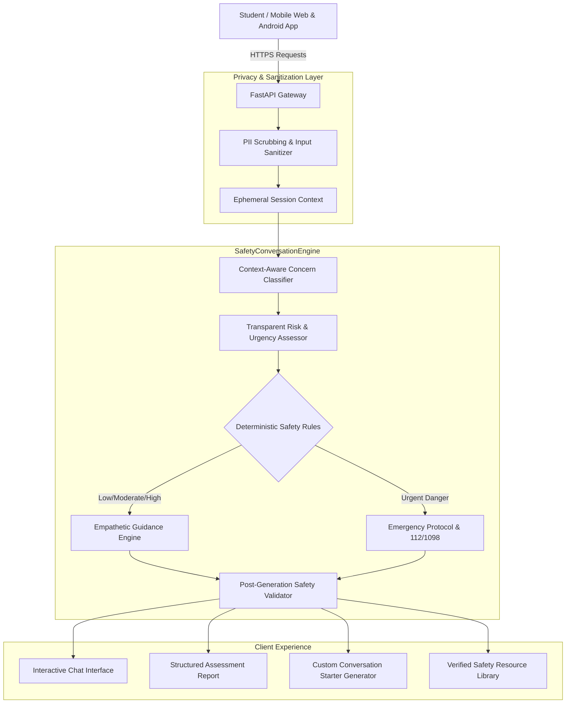

# SAKHI AI: Interactive AI-Powered School Well-Being and Safety Platform

<p align="center">
  
</p>

<p align="center">
  <strong>Your Voice. Your Safety. Your Space.</strong><br>
  <em>A privacy-first, age-sensitive AI companion for school students (ages 10–18) to express concerns privately, receive empathetic guidance, and safely self-advocate with trusted adults.</em>
</p>

---

## 1. Executive Summary & Problem Statement

Schoolgirls frequently experience peer bullying, online harassment, academic anxiety, or uncomfortable personal boundary violations. However, fear of retaliation, being disbelieved, or facing adult anger often prevents them from reporting problems early.

**SAKHI AI** bridges this critical gap. It provides an accessible, non-threatening, confidential digital sanctuary where a student can describe what she is experiencing in her own words. SAKHI:
- Validates her emotions without clinical jargon or patronizing language.
- Contextually assesses the concern type and urgency tier (Low, Moderate, High, Urgent).
- Outlines clear, proportionate, actionable steps.
- Equips the student with customized conversation starters to approach a trusted teacher, counselor, or parent.
- Highlights verified crisis helplines (112, 1098) when imminent physical safety is at stake.

---

## 2. System Architecture



---

## 3. Technology Stack

### Frontend
- **Framework**: React 18+ with TypeScript & Vite
- **Styling**: Tailwind CSS with custom lavender, teal, and warm sand palette
- **Animations**: Subtle micro-interactions, responsive touch targets, smooth transitions
- **Routing**: React Router DOM (v7)
- **Icons**: Lucide React
- **PWA & Mobile**: Configured with Capacitor 6 for native Android APK deployment

### Backend
- **Framework**: Python 3.11+ / FastAPI
- **Data Validation**: Pydantic v2
- **Server**: Uvicorn ASGI
- **Testing**: Pytest with automated test coverage
- **Security**: Regex PII scrubber, CORS whitelisting, sensitive payload redaction

### AI Safety Layer
- **Abstraction**: `SafetyConversationEngine`
- **Core Engine**: Deterministic, rule-based safety engine that runs **100% free with zero paid API dependencies**.
- **Optional LLM**: Environment-configured provider hook (Gemini / OpenAI / Anthropic) with strict fallback.
- **Safety Validator**: Post-generation regex audit that intercepts and overrides victim-blaming, dangerous advice, or false promises.

---

## 4. Privacy & Child Safety By Design

- **Zero Database Persistence**: Conversations exist only in ephemeral RAM during the active session. Nothing is written to an SQL/NoSQL database or server disk.
- **No Personal Identifiers Required**: Students never register, create passwords, or submit real names, phone numbers, or school IDs.
- **Automatic PII Redaction**: Any accidental phone numbers or email addresses are intercepted and replaced with `[REDACTED]` tokens prior to processing.
- **Instant Memory Wipe**: Clicking **"Clear Chat"** or **"Erase Session Data Now"** immediately purges the ephemeral context buffer.
- **Clear Limits of Confidentiality**: The app clearly discloses that it cannot dispatch emergency personnel and that real-world schools follow institutional child-protection mandates.

---

## 5. Repository Structure

```
Code2App/
├── backend/
│   ├── app/
│   │   ├── api/
│   │   │   ├── __init__.py
│   │   │   └── routes.py             # All /api/* FastAPI route handlers
│   │   ├── core/
│   │   │   ├── config.py             # Application settings & CORS
│   │   │   └── security.py           # PII scrubbing & sanitization
│   │   ├── data/
│   │   │   ├── demo_scenarios.json   # 6 Standardized fictional test cases
│   │   │   ├── emergency_contacts.json # Verified Indian helplines (112, 1098)
│   │   │   └── safety_resources.json # Curated educational articles
│   │   ├── schemas/                  # Pydantic request/response models
│   │   ├── services/
│   │   │   ├── conversation_engine.py# SafetyConversationEngine abstraction
│   │   │   ├── concern_classifier.py # Multi-category contextual classifier
│   │   │   ├── risk_assessor.py      # Transparent urgency engine
│   │   │   ├── safety_validator.py   # Post-generation policy auditor
│   │   │   ├── guidance_engine.py    # Action plans & conversation starters
│   │   │   └── resource_service.py   # Search and directory lookup
│   │   └── main.py                   # FastAPI app entry point
│   ├── tests/
│   │   ├── test_api.py               # End-to-end API test suite
│   │   └── test_safety_validator.py  # Zero-tolerance safety policy tests
│   ├── pytest.ini
│   ├── requirements.txt
│   └── .env.example
├── frontend/
│   ├── src/
│   │   ├── components/               # TopNavigation, MobileBottomNavigation, WelcomeHero, NextStepCard, SupportCategoryGrid, etc.
│   │   ├── context/                  # SessionContext (privacy-first in-memory state)
│   │   ├── pages/                    # 10 Application Screens
│   │   ├── services/api.ts           # Typed API client with timeout & offline fallback
│   │   ├── types/index.ts            # TypeScript interfaces
│   │   ├── __tests__/                # Vitest frontend test suite
│   │   ├── App.tsx                   # Routing & global layout
│   │   ├── index.css                 # Design system tokens & fonts
│   │   └── main.tsx
│   ├── capacitor.config.ts           # Mobile deployment config
│   ├── tailwind.config.js
│   ├── package.json
│   └── android/                      # Native Android project structure
├── mobile/
│   └── README.md                     # Android Studio APK build guide
├── DEMO_SCRIPT.md                    # 2-Minute competition presentation script
└── README.md
```

---

## 6. Getting Started & Execution

### Prerequisites
- Python 3.11+
- Node.js v18+ (v22+ recommended)
- Git

### Step 1: Clone & Configure Backend
```bash
# Navigate to backend directory
cd backend

# Create and activate virtual environment
python -m venv .venv

# Windows PowerShell:
.\.venv\Scripts\Activate.ps1
# macOS/Linux:
# source .venv/bin/activate

# Install dependencies
pip install -r requirements.txt

# Run backend server
python -m uvicorn app.main:app --host 127.0.0.1 --port 8000 --reload
```
The FastAPI backend will start at `http://127.0.0.1:8000`.  
Interactive API Documentation is available at `http://127.0.0.1:8000/docs`.

### Step 2: Configure & Start Frontend
In a new terminal:
```bash
# Navigate to frontend directory
cd frontend

# Install dependencies
npm install

# Start Vite development server
npm run dev
```
The React frontend will be live at `http://127.0.0.1:5173`.

---

## 7. Running Automated Tests

A comprehensive Pytest suite validates all endpoints, urgency levels, safety overrides, false-positive handling, and PII scrubbing:

```bash
cd backend
.\.venv\Scripts\pytest -v
```

### Verified Test Coverage:
- `test_health_endpoint`: Health and privacy flags.
- `test_privacy_endpoint`: Zero-storage policy validation.
- `test_resources_and_emergency_directory`: Verified 112, 1098 helplines.
- `test_demo_scenarios_all_tiers`: Coverage of Low, Moderate, High, Urgent.
- `test_chat_empty_and_oversized_validation`: Edge-case input validation.
- `test_chat_academic_stress_low_urgency`: Study pacing guidance.
- `test_chat_repeated_bullying_moderate_urgency`: Multi-day peer harassment.
- `test_chat_cyberbullying`: Group chat and digital screenshot advice.
- `test_chat_threats_and_blackmail_high_urgency`: Anti-extortion guidance.
- `test_chat_immediate_danger_urgent`: Active physical intrusion handling.
- `test_chat_false_positive_metaphor`: Rejects false alarms like *"killing time"*.
- `test_pii_scrubbing_in_chat`: Verifies phone number redaction.
- `test_assessment_and_guidance_consistency`: Aligned output schemas.
- `test_victim_blaming_rejection`: Enforces zero victim-blaming policy.
- `test_dangerous_confrontation_advice_rejection`: Prevents unsafe solo confrontation.
- `test_medical_diagnosis_rejection`: Prevents unauthorized psychiatric diagnoses.
- `test_false_guarantee_rejection`: Prohibits claiming police dispatch.

---

## 8. API Specification

| Method | Endpoint | Description |
|:---|:---|:---|
| `GET` | `/api/health` | Service status, engine mode, privacy flags |
| `GET` | `/api/privacy` | Transparent data retention policy and confidentiality limits |
| `GET` | `/api/resources` | Query safety articles and self-advocacy guides |
| `GET` | `/api/resources/emergency` | Verified 24/7 crisis helplines (112, 1098, 1091, 1930, 14416) |
| `GET` | `/api/scenarios` | 6 Fictional demo scenarios for evaluation |
| `POST` | `/api/chat` | Send student message; returns structured response |
| `POST` | `/api/assess` | Generate structured concern assessment and indicators |
| `POST` | `/api/guidance` | Generate 5-part plan and adult conversation starter |
| `POST` | `/api/safety/check` | Content safety audit against zero-tolerance rules |

---

## 9. Android APK Packaging (Capacitor)

The mobile delivery layer is pre-configured with Capacitor:

1. Build production web bundle:
   ```bash
   cd frontend
   npm run build
   ```
2. Sync with Android platform:
   ```bash
   npx cap sync android
   ```
3. Open in Android Studio:
   ```bash
   npx cap open android
   ```
4. Build APK:
   Select **Build > Build Bundle(s) / APK(s) > Build APK(s)** in Android Studio.  
   The resulting debug APK will be located at:
   `frontend/android/app/build/outputs/apk/debug/app-debug.apk`

Detailed steps are provided in [`mobile/README.md`](mobile/README.md).

---

## 10. Competition Evaluation & Fictional Scenarios

For judges and evaluators, navigate to the **"Demo Cases"** tab in the application (`/scenarios`) to test all 4 urgency tiers:
1. **Case 1 (Low)**: Everyday exam anxiety and sleeplessness.
2. **Case 2 (Moderate)**: Repeated classroom teasing and lunch exclusion.
3. **Case 3 (Moderate/High)**: Cyberbullying and unauthorized memes in group chat.
4. **Case 4 (High)**: Uncomfortable personal boundary violation and secrecy pressure.
5. **Case 5 (High)**: Extortion message demanding money/photos.
6. **Case 6 (Urgent)**: Immediate physical entrapment / active intrusion.

Each case can be launched directly into the interactive chat with 1 click.

---

## 11. Ethical Notice & Real-World Deployment

SAKHI AI is designed as a student empowerment and self-advocacy tool. In any real-world school deployment, the platform must be integrated with the school's designated Child Protection Committee (CPC) and comply with national child protection legislation (e.g., POCSO Act in India, COPPA/FERPA in the US). SAKHI AI does not replace licensed counselors or law enforcement.
